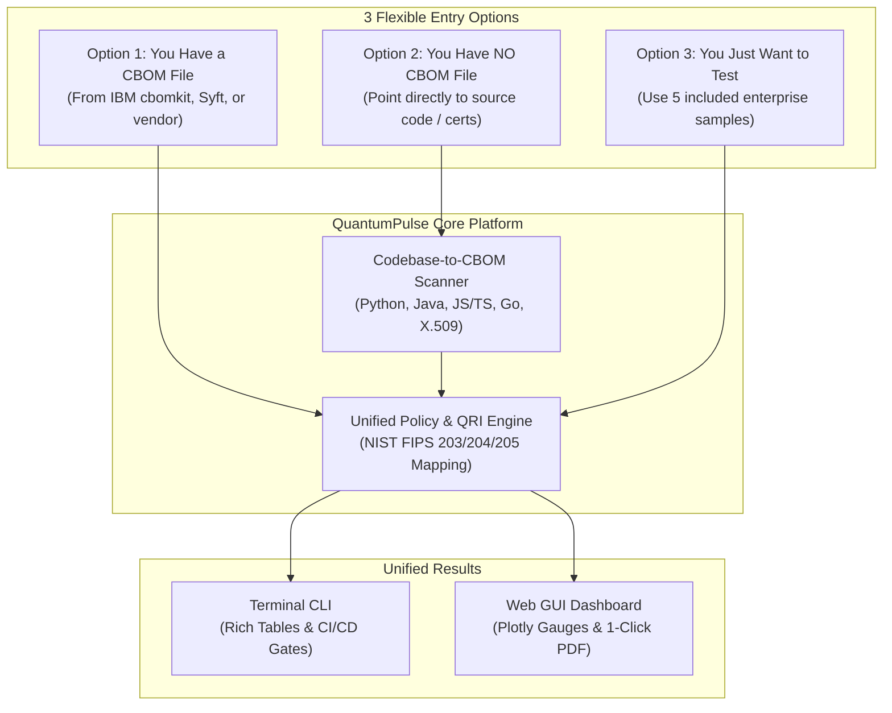
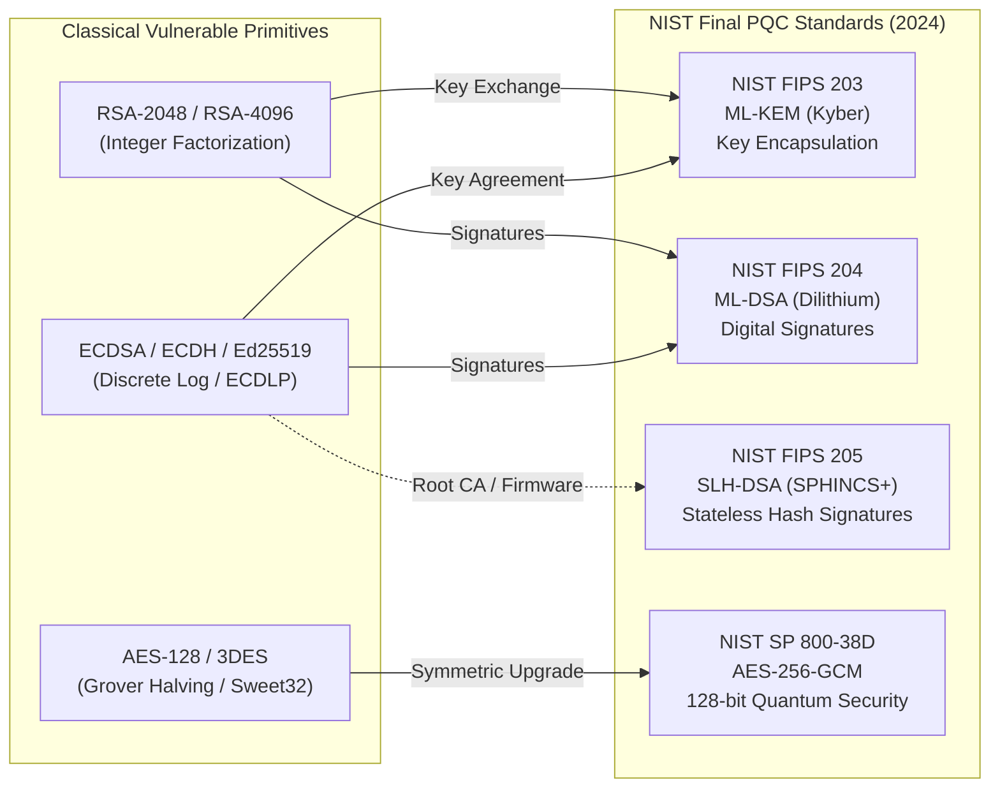

# 🛡️ QuantumPulse

**Cryptographic Bill of Materials (CBOM) Analyzer & NIST Post-Quantum Cryptography (PQC) Migration Advisor**

[](https://www.python.org/downloads/)
[-green.svg)](https://cyclonedx.org/capabilities/cbom/)
[](https://csrc.nist.gov/projects/post-quantum-cryptography)
[]()
[](Dockerfile)
[](LICENSE)
[]()

---

## 📖 Table of Contents
1. [Overview & Core Value Proposition](#-overview--core-value-proposition)
2. [Do You Need a Pre-Existing CBOM File? (No!)](#-do-you-need-a-pre-existing-cbom-file-no)
3. [Why Industry Needs QuantumPulse (Key Benefits)](#-why-industry-needs-quantumpulse-key-benefits)
4. [Quickstart Guide (Linux / Kali Linux / macOS / Windows / Docker)](#-quickstart-guide-linux--kali-linux--macos--windows--docker)
5. [Running the Command Line Interface (CLI)](#-running-the-command-line-interface-cli)
6. [Running the Interactive Web GUI Dashboard](#-running-the-interactive-web-gui-dashboard)
7. [Automated Migration Code Patcher](#-automated-migration-code-patcher)
8. [Codebase-to-CBOM Scanner (Solving the Industry Generation Gap)](#-codebase-to-cbom-scanner-solving-the-industry-generation-gap)
9. [NIST Post-Quantum Cryptography Standards Alignment](#-nist-post-quantum-cryptography-standards-alignment)
10. [Mathematical Formulation: Quantum Risk Index (QRI)](#-mathematical-formulation-quantum-risk-index-qri)
11. [CI/CD SDLC Governance Gates (SARIF Integration)](#-cicd-sdlc-governance-gates-sarif-integration)
12. [Performance Benchmarks](#-performance-benchmarks)
13. [Sample Audit PDF Report](#-sample-audit-pdf-report)

---

## 🌟 Overview & Core Value Proposition

**QuantumPulse** is an enterprise-grade cryptographic governance, risk modeling, and post-quantum migration platform. As cryptographically relevant quantum computers (CRQCs) approach reality, classical public-key cryptography (RSA, ECC, Diffie-Hellman) will be rendered obsolete by Shor's algorithm. 

Adversaries are actively executing the **"Harvest Now, Decrypt Later" (HNDL)** attack model: capturing encrypted enterprise network traffic and intellectual property today to decrypt retroactively once quantum hardware matures.

Rather than relying on primitive regular-expression source code scrapers that trigger massive false-positive noise, QuantumPulse establishes a **governance-first architecture**:
1. It ingests or generates machine-readable **Cryptographic Bills of Materials (CBOMs)** serialized in the international **CycloneDX 1.6 (ECMA-424)** standard.
2. It audits algorithm primitives, operational modes, key lengths, and certificate lifetimes against declarative compliance rules.
3. It computes a mathematically grounded **Quantum Risk Index (QRI)** $[0 - 100]$ incorporating data shelf-life horizons.
4. It maps legacy primitives directly to the finalized **NIST Post-Quantum Standards (FIPS 203, FIPS 204, FIPS 205)** with quantified key size and latency overheads.
5. It offers both a **developer-friendly Terminal CLI (Typer + Rich)** and a **CISO Web GUI Dashboard (Streamlit + Plotly)** with **1-click executive PDF export**.

---

## 💡 Do You Need a Pre-Existing CBOM File? (No!)

**No. You do NOT need a pre-existing CBOM file to use QuantumPulse.**

QuantumPulse supports **three flexible entry paths**:



1. **Option 1 (You have raw code, no CBOM):** Run our built-in scanner (`python cli/main.py generate ./my_code --scan` or use the Web GUI *"Direct Codebase Scanner"*). It inspects Python, Java, JS/TS, Go, and certificates, synthesizes a CycloneDX 1.6 CBOM, and audits it immediately.
2. **Option 2 (You have an existing CBOM file):** Pass it directly (`python cli/main.py scan my_cbom.json`).
3. **Option 3 (Instant Evaluation):** Load any of the **5 pre-packaged enterprise sample CBOMs** in `samples/` with a single click.

---

## 🎯 Why Industry Needs QuantumPulse (Key Benefits)

| Enterprise Liability | Legacy Approach (SAST / Regex) | QuantumPulse Solution |
| :--- | :--- | :--- |
| **Crypto-Sprawl & Shadow IT** | Security teams lack a structured inventory of active algorithms, certificate chains, and key lengths across microservices. | Ingests or generates standardized **CycloneDX 1.6 (ECMA-424)** CBOMs, creating a centralized, machine-readable cryptographic inventory. |
| **False-Positive Noise** | Primitive regex scanners flag benign file integrity hashes (e.g., non-security MD5/SHA-1 in logging/ETags) with the same severity as password storage. | **Contextual Intent Heuristics:** Automatically evaluates operational wrappers; benign non-security caches are downgraded to Low, while authentication boundaries escalate to Critical. |
| **Harvest Now, Decrypt Later (HNDL)** | Organizations treat quantum risk as a problem for 2035+, ignoring that data intercepted today will be retroactively decrypted. | **HNDL Horizon Modeling:** Prioritizes key exchange protocols (ECDH, RSA transport) and long shelf-life data (>10 years) for **Tier 1 Immediate Remediation**. |
| **Lack of CBOM Tooling in Enterprise** | Most corporate repositories do not yet have automated CBOM pipelines or commercial scanners installed. | **Built-in Codebase Scanner ([`core/generator.py`](file:///d:/Antigravity/QuantumPulse/core/generator.py)):** Scans Python, Java, JS/TS, Go, and X.509 certs to synthesize a CycloneDX 1.6 CBOM directly from any directory. |
| **Audit-Gap Fragility** | Real-world manifests often have incomplete metadata (missing key sizes or modes); legacy parsers crash with validation errors. | **Zero-Crash Resilience:** Tags unverified fields as *Audit Gaps* and calculates a transparent *Analysis Confidence Score* $[0\% - 100\%]$. |
| **Actionable Refactoring** | Traditional tools output vague warnings like "Upgrade RSA" without code or trade-off guidance. | **Automated Code Patcher ([`core/patcher.py`](file:///d:/Antigravity/QuantumPulse/core/patcher.py)):** Outputs drop-in Python, Java, and OpenSSL 3.x hybrid migration code wrappers (`X25519+ML-KEM-768`). |
| **Executive & Regulatory Pressure** | CISOs struggle to justify post-quantum budgets to boards and lack automated compliance reporting for US Executive Order 14028 / CNSA 2.0. | Generates **1-Click Executive PDF Reports** with risk gauges, posture tiering, and compliance scores, alongside machine-readable **SARIF** for CI/CD gates. |

---

## 🚀 Quickstart Guide (Linux / Kali Linux / macOS / Windows / Docker)

QuantumPulse is designed to be **cloned and executed immediately on ANY operating system**—including **Kali Linux**, Ubuntu, Debian, macOS, and Windows.

### 🐧 Running on Linux (Kali Linux, Ubuntu, Debian)

On Kali Linux or modern Debian/Ubuntu, Python environments are managed via virtual environments (`PEP 668`). Follow these steps:

```bash
# 1. Clone the repository
git clone https://github.com/dikshantdabodia-png/QuantumPulse.git
cd QuantumPulse

# 2. Create and activate a virtual environment
python3 -m venv venv
source venv/bin/activate

# 3. Install dependencies
pip install -r requirements.txt

# (Optional) Install QuantumPulse as a global terminal command:
pip install -e .

# 4. Verify installation (all 21 unit tests should pass)
python3 -m pytest tests/
```

### 🪟 Running on Windows (PowerShell / Command Prompt)

```powershell
# 1. Clone the repository
git clone https://github.com/dikshantdabodia-png/QuantumPulse.git
cd QuantumPulse

# 2. Create and activate virtual environment
python -m venv venv
.\venv\Scripts\Activate.ps1

# 3. Install dependencies
pip install -r requirements.txt

# 4. Verify test suite
python -m pytest tests/
```

### 🐳 Running via Docker (Zero Local Dependencies)

```bash
# 1. Build Docker image
docker build -t quantumpulse .

# 2. Run Web GUI on http://localhost:8501
docker run -p 8501:8501 quantumpulse

# 3. Or run CLI scan inside container
docker run quantumpulse python cli/main.py scan samples/enterprise_banking_cbom.json
```

---

## 💻 Running the Command Line Interface (CLI)

The CLI is powered by **Typer** and **Rich** to provide colorful terminal tables, executive risk panels, and CI/CD gate exit codes.

### 1. Basic Manifest Scan (Terminal Rich Mode)
Scan any CycloneDX CBOM file and view the colored interactive inventory:
```bash
python cli/main.py scan samples/enterprise_banking_cbom.json
```

### 2. Export Executive Audit PDF Report
Generate a complete executive PDF document with tables, badges, and remediation plans:
```bash
python cli/main.py scan samples/enterprise_banking_cbom.json --format pdf --output banking_audit.pdf
```

### 3. Generate CBOM Directly from Source Code or GitHub
Scan a local directory OR a public GitHub repository URL without needing any pre-existing CBOM:
```bash
# Scan local folder:
python cli/main.py generate ./my_code_folder -o generated_cbom.json --scan

# Scan remote GitHub repository directly:
python cli/main.py generate https://github.com/owner/repo -o repo_cbom.json --scan
```

### 4. Automated Code Migration Patching
Get copy-pasteable hybrid migration code snippets right in your terminal:
```bash
python cli/main.py patch RSA -t ML-KEM-768
python cli/main.py patch ECDSA -t ML-DSA-65
python cli/main.py patch AES-128 -t AES-256-GCM
python cli/main.py patch ECDH -t ML-KEM-768 --lang openssl
```

### 5. CI/CD Governance Gate Mode (Automated Pipeline Failure)
Enforce cryptographic governance in continuous integration pipelines. Block pull requests if deprecated algorithms are introduced:
```bash
# Fails with exit code 1 if any broken primitives (DES, 3DES, MD5) exist
python cli/main.py scan manifest.json --fail-on-broken

# Fails with exit code 3 if overall QRI exceeds threshold of 50.0
python cli/main.py scan manifest.json --max-qri 50.0

# Export findings to SARIF format for GitHub Code Scanning tab
python cli/main.py scan manifest.json --format sarif --output results.sarif
```

### 6. Compare Two CBOMs (Migration Delta & Risk Reduction)
Compare a pre-migration baseline against an upgraded target to prove cryptographic risk reduction:
```bash
python cli/main.py compare samples/enterprise_banking_cbom.json samples/cloud_microservice_pqc_cbom.json
```

### 7. Run Empirical Stress Benchmarks
Benchmark parsing and policy evaluation throughput across small to massive enterprise datasets (10 to 5,000+ assets):
```bash
python cli/main.py benchmark --counts 10,100,500,1000,2500
```

---

## 🌐 Running the Interactive Web GUI Dashboard

Launch the browser-based executive dashboard powered by **Streamlit** and **Plotly**:

```bash
streamlit run gui/dashboard.py
```
*Note: If running on a remote headless Kali Linux or cloud server over SSH, launch with:*
```bash
streamlit run gui/dashboard.py --server.headless true --server.port 8501 --server.address 0.0.0.0
```
Then open `http://localhost:8501` (or `http://<server-ip>:8501`) in your browser.

### 🌟 GUI Dashboard Features:
1. **Direct Codebase & GitHub Scanner Mode:** Enter any local project directory path OR paste a public GitHub repository URL (e.g., `https://github.com/owner/repo`), then click **"🚀 Scan Codebase & Synthesize CBOM"** to clone, generate, and audit a CBOM in seconds.
2. **Sample Loader & File Uploader:** 
   - 1-click loading of any of the **5 included enterprise sample CBOMs** from the sidebar dropdown.
   - Or drag-and-drop your own custom `.json` CBOM file.
3. **Executive Overview Tab:**
   - **Interactive Plotly Speedometer Gauge:** Instant visual posture tiering (Safe, Low, Medium, High, Critical).
   - **Cryptographic Taxonomy Sunburst/Pie Chart:** Distribution of algorithms across families.
   - **HNDL Threat Index & Confidence Cards.**
4. **Cryptographic Inventory Tab:**
   - Filterable, searchable table of all discovered primitives with OWASP A02 tags.
5. **NIST PQC Migration Advisor Tab:**
   - Side-by-side **Performance Trade-Off Bar Chart** comparing key size growth and signature/ciphertext expansion.
   - **Drop-in Implementation Code Snippets:** Expandable code patches for each finding.
6. **CycloneDX ECMA-424 Compliance Tab:**
   - Standards Adherence Rating ($0 - 100\%$) and taxonomy coverage audit.
7. **Reports & Exports Center:**
   - **1-Click Download Executive PDF Report** (generated dynamically via ReportLab).
   - **Download SARIF v2.1.0** (for GitHub/GitLab security tabs).
   - **Download JSON & Markdown.**
8. **Migration Progress Delta Mode:**
   - Select baseline vs. post-remediation CBOMs to visualize side-by-side risk score reduction and remediated algorithms.

---

## 🛠️ Automated Migration Code Patcher

QuantumPulse provides drop-in refactoring templates to help engineering teams migrate legacy code to post-quantum and hybrid schemes:

```python
# Generated by QuantumPulse: Dual-Mode Hybrid Key Exchange Wrapper (X25519 + ML-KEM-768)
import oqs
from cryptography.hazmat.primitives.asymmetric import x25519
from cryptography.hazmat.primitives import hashes
from cryptography.hazmat.primitives.kdf.hkdf import HKDF

def hybrid_key_exchange_sender():
    # 1. Classical Ephemeral Keypair (X25519)
    classical_priv = x25519.X25519PrivateKey.generate()
    classical_pub = classical_priv.public_key()
    
    # 2. Post-Quantum KEM (NIST FIPS 203 ML-KEM-768)
    with oqs.KeyEncapsulation("ML-KEM-768") as client:
        pqc_pub = client.generate_keypair()
        return classical_priv, classical_pub, pqc_pub
```

---

## 🏛️ NIST Post-Quantum Cryptography Standards Alignment

QuantumPulse is built strictly upon the **finalized August 2024 NIST Post-Quantum Standards**:



---

## 🔬 Mathematical Formulation: Quantum Risk Index (QRI)

The platform calculates a deterministic, transparent **Quantum Risk Index (QRI)**:

$$\text{Asset QRI} = W_{\text{alg}} \times V_{\text{quantum}} \times C_{\text{asset}} \times T_{\text{exposure}}$$

$$\text{System QRI} = \min\left(100.0, \, \left(\frac{1}{N} \sum_{i=1}^N \text{Asset QRI}_i \times 0.60\right) + \left(\max_i(\text{Asset QRI}_i) \times 0.40\right)\right)$$

- **$W_{\text{alg}}$:** Algorithmic vulnerability weight ($8.0$ for broken, $5.0$ for Shor-vulnerable, $1.8$ for Grover-affected, $0.0$ for quantum-safe).
- **$V_{\text{quantum}}$:** Susceptibility to Shor's algorithm ($1.0$), Grover search ($0.4$), or Safe ($0.0$). Classically broken primitives evaluate to $1.0$.
- **$C_{\text{asset}}$:** Enterprise criticality rating ($3.0$ for financial/PII, $2.0$ for public TLS/VPN, $1.0$ for internal test).
- **$T_{\text{exposure}}$:** Data shelf-life / HNDL factor ($2.5$ for long-term secret data $>10$ years, $2.0$ for recorded network traffic, $1.0$ for non-sensitive cache).

---

## 🔄 CI/CD SDLC Governance Gates (SARIF Integration)

QuantumPulse integrates natively into **GitHub Actions** and **GitLab CI** to enforce "Shift-Left" cryptographic governance.

Included in `.github/workflows/quantumpulse-gate.yml`:
```yaml
name: QuantumPulse PQC Security Gate

on: [push, pull_request]

jobs:
  pqc-audit:
    runs-on: ubuntu-latest
    steps:
      - uses: actions/checkout@v4
      - name: Set up Python
        uses: actions/setup-python@v5
        with:
          python-version: '3.12'

      - name: Install QuantumPulse
        run: pip install -r requirements.txt

      - name: Scan CBOM & Fail on Policy Violation
        run: |
          python cli/main.py scan samples/enterprise_banking_cbom.json \
            --format sarif --output results.sarif \
            --fail-on-broken --max-qri 60.0

      - name: Upload SARIF to GitHub Security Tab
        if: always()
        uses: github/codeql-action/upload-sarif@v3
        with:
          sarif_file: results.sarif
```

---

## ⚡ Performance Benchmarks

Empirical performance evaluation across synthetic enterprise manifests:

| Cryptographic Assets | Total Latency | Processing Throughput | Peak RAM Footprint |
| :---: | :---: | :---: | :---: |
| **10 assets** | 0.0079 s | **1,265 assets/sec** | 0.07 MB |
| **100 assets** | 0.0621 s | **1,609 assets/sec** | 0.43 MB |
| **500 assets** | 0.2920 s | **1,712 assets/sec** | 2.13 MB |
| **1,000 assets** | 0.6071 s | **1,647 assets/sec** | 4.34 MB |
| **2,500 assets** | 1.4812 s | **1,688 assets/sec** | 10.82 MB |
| **5,000 assets** | 2.9430 s | **1,698 assets/sec** | 21.65 MB |

---

## 📄 Sample Audit PDF Report

An authentic executive audit PDF pre-generated by QuantumPulse is available directly in the repository:
👉 **[`samples/sample_executive_audit.pdf`](file:///d:/Antigravity/QuantumPulse/samples/sample_executive_audit.pdf)**
